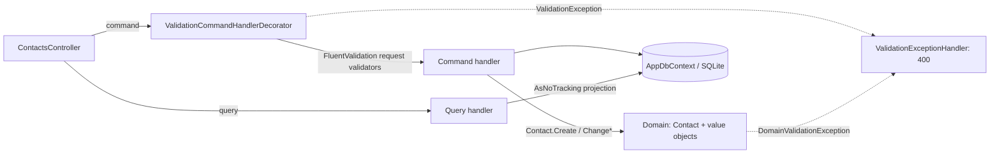
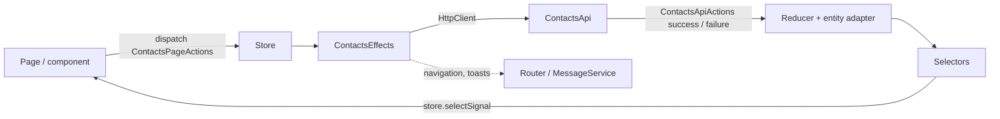

# ContactHub

A small, single-user web app for managing personal contacts, built as an interview task
([requirements](Docs/Requirements.md), [design plan](Docs/plan.md)).

Each contact has a **first name**, **surname**, **date of birth**, **address** (street, postal
code, city, country), **phone number** and **IBAN**. You can list, view, create, edit and delete
contacts, and they are stored in SQLite. There are no accounts. The app has one anonymous user.

Stack: ASP.NET Core Web API (.NET 10, controllers, EF Core + SQLite, FluentValidation, hand-rolled
CQRS) and Angular (ngrx, PrimeNG with the Aura theme, Tailwind CSS v4 for layout), with Vitest,
NUnit and Playwright tests, Docker Compose and GitHub Actions.

## How to run

**Prerequisites:** .NET SDK 10 (pinned in `global.json`) and Node 24 (`.nvmrc`). Docker is only
needed for Compose.

| What | Command | Result |
| --- | --- | --- |
| Backend | `cd backend && dotnet run --project Api` | API on http://127.0.0.1:8080, Swagger UI at http://127.0.0.1:8080/swagger |
| Frontend | `cd frontend && npm install && npm run start` | App on http://127.0.0.1:4700; `/api` is proxied to the backend (`frontend/proxy.conf.js`) |
| Whole stack | `docker compose up --build` | Backend on port 8080, frontend dev server on port 4700 |
| Backend tests | `cd backend && dotnet test` | NUnit: domain unit tests and endpoint tests through `WebApplicationFactory` |
| Frontend tests | `cd frontend && npm test -- --watch=false` | Vitest: reducer, selectors, effects, API service, validators, components |
| E2E test | `dotnet run --project e2e/ContactHub.E2E` (from the repo root) | .NET console app using Microsoft.Playwright (Chromium); starts the backend and the dev server itself, exits non-zero on failure (first time: `dotnet run --project e2e/ContactHub.E2E -- install chromium`) |
| Lint | `cd backend && dotnet format --verify-no-changes` · `cd e2e && dotnet format --verify-no-changes` · `cd frontend && npm run lint` | |

**Where the data lives.** The connection string is `Data Source=database/contacthub.db`. A
relative path is resolved against the running app's folder (`AppContext.BaseDirectory`), not the
working directory. Locally the file is
`backend/Api/bin/Debug/net10.0/database/contacthub.db`. Startup creates the folder and runs
`Database.Migrate()`, so the database is created on first run. Tests use `contacthub_test.db` in
the test project's output folder, and the e2e run uses `contacthub_e2e.db`, which is deleted
before each run. In Docker Compose the backend mounts the named volume `dbdata` on
`/app/database`. Running `dotnet clean` or deleting `bin/` wipes local data.

CI (`.github/workflows/ci.yml`) runs backend, frontend and e2e jobs on every push.
`.github/workflows/release.yml` builds a single image (API plus the built Angular app) and pushes
it to GHCR on `main`.

## Architecture

### Backend: one project, four layers

`backend/Api/` is one ASP.NET Core project, split into folders:

- **Domain/**: the `Contact` aggregate and the value objects `Address`, `PhoneNumber` and `Iban`.
  Setters are private. `Contact.Create(...)` is the factory, and the behaviour methods `Rename`,
  `ChangeDateOfBirth`, `ChangeAddress`, `ChangePhoneNumber` and `ChangeIban` re-check the
  invariants and bump `UpdatedAt` only when a value actually changes. Ids are `Guid` v7, and the
  clock comes from an injected `TimeProvider`.
- **Application/**: CQRS without MediatR. `ICommand<T>`, `IQuery<T>`, `ICommandHandler<,>` and
  `IQueryHandler<,>` live in `Abstractions.cs`. There is one file per use case in
  `Application/Contacts/`, holding the command or query, its request validator and its handler.
  Queries read with `AsNoTracking`.
- **Data/**: `AppDbContext` and `ContactConfiguration`. `Address` is an EF complex property,
  `PhoneNumber` and `Iban` are stored through value converters, and `DateOfBirth` is a `DateOnly`.
  Migrations are in `Migrations/`.
- **Controllers/**: thin `[ApiController]` classes. Each action takes the handler via
  `[FromServices]`, dispatches the command or query, and maps the result to an HTTP status. Two
  `IExceptionHandler`s map validation errors to `400 ValidationProblem` and `NotFoundException` to
  `404 ProblemDetails`.

Hosting uses the classic `Program` + `Startup` model. `Startup.ConfigureServices` calls
`AddApplication()`, which scans the assembly, registers every handler, and wraps each command
handler in `ValidationCommandHandlerDecorator`.

### Validation layers

1. **Request (Application):** FluentValidation validators such as `CreateContactCommandValidator`
   and `UpdateContactCommandValidator`, run by the decorator before the handler. They reuse the
   domain rules (`PhoneNumber.IsValid`, `Iban.IsValid`, the length constants on the entity).
2. **Entity (Domain):** `ContactValidator` (an `AbstractValidator<Contact>`) runs inside
   `Contact.Create` and every behaviour method. It checks name lengths and that the date of birth
   is not in the future and not more than 150 years ago. A failure throws
   `DomainValidationException`.
3. **Value objects (Domain):** `Address.Create` (with `AddressValidator`), `PhoneNumber.Create`
   (an optional leading `+` followed by 7 to 15 digits, normalized) and `Iban.Create` (format check
   and ISO 13616 mod-97 checksum, normalized, `ToFormatted()` in groups of four). An invalid
   value object cannot be constructed.
4. **Client:** typed Reactive Forms in `ContactForm` check required fields and lengths, and use
   the `ibanValidator`, `phoneValidator` and `dateOfBirthValidator` from
   `components/contact-form/validators.ts`. Server `400` field errors (camelCase keys such as
   `address.city`) are shown under the matching inputs.

### Frontend: ngrx data flow

- **Actions** (`contacts.actions.ts`): `createActionGroup` defines page actions (opened, create,
  update and delete submitted, search changed) and API actions (success and failure for each call).
- **Effects** (`contacts.effects.ts`): call the typed `ContactsApi` (`src/app/api/contacts-api.ts`)
  and dispatch the API actions. Navigation and toasts are non-dispatching effects.
- **Reducer** (`contacts.reducer.ts`): a `createFeature` with an `@ngrx/entity` adapter (sorted by
  surname, then first name) plus `loadStatus`, `detailStatus`, `saveStatus`, `error`,
  `fieldErrors` and `query`.
- **Selectors:** feature selectors plus `selectAllContacts`, `selectFilteredContacts`,
  `selectIsEmpty`, and `selectSelectedContact` (from the router-store `id` param).
- **Components** read state as signals with `store.selectSignal(...)`. Routes are lazy-loaded with
  `loadComponent`.

## Requirements to code

| Requirement | Where |
| --- | --- |
| Data persisted | `backend/Api/Startup.cs` (SQLite path, `Database.Migrate()`), `compose.yml` (`dbdata` volume) |
| EF Core | `backend/Api/Data/AppDbContext.cs`, `backend/Api/Data/ContactConfiguration.cs`, `backend/Api/Migrations/` |
| FluentValidation (models) | `backend/Api/Application/Contacts/CreateContact.cs`, `backend/Api/Application/Contacts/UpdateContact.cs`, `backend/Api/Application/ValidationCommandHandlerDecorator.cs` |
| FluentValidation (entities) | `backend/Api/Domain/Contact.cs` (`ContactValidator`), `backend/Api/Domain/Address.cs` (`AddressValidator`) |
| CQRS | `backend/Api/Application/Abstractions.cs`, `backend/Api/Application/ApplicationServiceCollectionExtensions.cs`, `backend/Api/Application/Contacts/`, `backend/Api/Controllers/ContactsController.cs` |
| Rich Domain Model | `backend/Api/Domain/Contact.cs`, `backend/Api/Domain/Address.cs`, `backend/Api/Domain/PhoneNumber.cs`, `backend/Api/Domain/Iban.cs`, `backend/Api/Domain/DomainValidationException.cs` |
| ngrx Store | `frontend/src/app/store/contacts/`, `frontend/src/app/app.config.ts`, `frontend/src/app/api/contacts-api.ts` |
| PrimeNG components | `frontend/src/app/app.config.ts` (`providePrimeNG`, Aura), `frontend/src/app/pages/contacts/contacts.html` (Table, ConfirmDialog), `frontend/src/app/components/contact-form/contact-form.html` (InputText, DatePicker, Fieldset), `frontend/src/app/components/layout/layout.html` |
| Playwright e2e test | `e2e/ContactHub.E2E/` (.NET console app, `Program.Main`), `e2e` job in `.github/workflows/ci.yml` |
| Tests | `backend/Api.Tests/DomainTests.cs`, `backend/Api.Tests/ContactsEndpointTests.cs`, `*.spec.ts` next to the frontend code |

## Contact list features

The `/contacts` page (`frontend/src/app/pages/contacts/`) is built for quickly finding a contact:

- **Search:** one box filters by name, phone number, IBAN or city. The term is stored in the ngrx
  `query` state through a `searchChanged` action, so it survives navigating to a contact and back.
  The memoized `selectFilteredContacts` selector (`frontend/src/app/store/contacts/`) does the
  filtering on the client. Matching ignores case and whitespace, so `de89 3704` finds a formatted
  IBAN. If nothing matches, the page shows a "No matches" state.
- **Sorting:** on wider screens you can sort by any column. By default the list is ordered by surname, then first
  name.
- **Paging:** the PrimeNG paginator pages through the filtered results.
- **Mobile:** on narrow screens (checked at 375 px) the table collapses to stacked rows and the form
  switches to one column.

All of this happens on the client. Server-side search and paging were left out on purpose,
because a personal contact list stays small.
