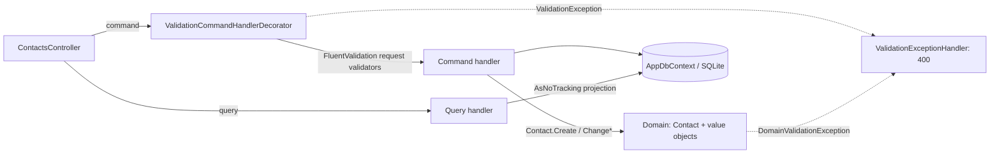
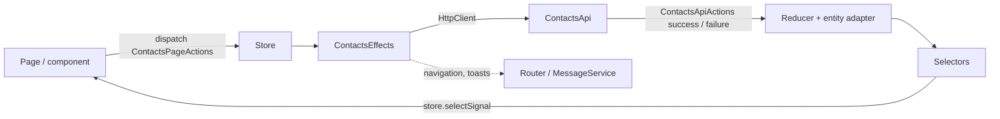

# Architecture

Detailed design notes for ContactHub. For a short overview and how to run the app, see the
[README](../README.md).

## Backend

Each layer is its own project, and references point inward only
(`ContactHub.Api` → `ContactHub.Infrastructure` → `ContactHub.Application` → `ContactHub.Domain`).
`ContactHub.Api.Tests/Architecture/ArchitectureTests.cs` (NetArchTest) fails the build if a layer references
the wrong one.

```text
backend/
├── ContactHub.Domain/
│   ├── Entities/       Contact (+ ContactValidator)
│   ├── ValueObjects/   Address, PhoneNumber, Iban
│   └── Exceptions/     DomainValidationException, ValidationKeys
├── ContactHub.Application/
│   ├── Contacts/
│   │   ├── ContactDto.cs
│   │   ├── Commands/   CreateContact/, UpdateContact/, DeleteContact/   (Command, Validator, Handler)
│   │   └── Queries/    GetContactById/, GetContacts/                     (Query, Handler)
│   ├── Abstractions/   ICommand, IQuery, ICommandHandler, IQueryHandler, Unit, IAppDbContext
│   ├── Behaviors/      ValidationCommandHandlerDecorator
│   ├── Exceptions/     NotFoundException
│   └── DependencyInjection.cs   AddApplication()
├── ContactHub.Infrastructure/
│   ├── Persistence/    AppDbContext (: IAppDbContext), DemoDataSeeder, Configurations/, Migrations/
│   └── DependencyInjection.cs   AddInfrastructure()
├── ContactHub.Api/     web host
│   ├── Controllers/    ContactsController, HealthController
│   ├── Middleware/     ValidationExceptionHandler, NotFoundExceptionHandler
│   ├── Extensions/     SwaggerTopBar
│   └── Program.cs, Startup.cs, appsettings*.json
├── ContactHub.Api.Tests/               unit tests in Domain/, Application/, Infrastructure/, Api/, Architecture/ (+ Common/ helpers)
└── ContactHub.Api.Integration.Tests/   HTTP endpoints via WebApplicationFactory
```

Namespaces follow the projects and folders (`ContactHub.Application.Contacts.Commands.CreateContact`,
`ContactHub.Domain.Entities`, ...). New migrations:
`dotnet ef migrations add <Change> --project ContactHub.Infrastructure --startup-project ContactHub.Api`.

- **Domain/**: the `Contact` aggregate and the value objects `Address`, `PhoneNumber` and `Iban`.
  Setters are private. `Contact.Create(...)` is the factory, and the behaviour methods `Rename`,
  `ChangeDateOfBirth`, `ChangeAddress`, `ChangePhoneNumber` and `ChangeIban` re-check the
  invariants and bump `UpdatedAt` only when a value actually changes. Ids are `Guid` v7, and the
  clock comes from an injected `TimeProvider`.
- **Application/**: CQRS without MediatR. `ICommand<T>`, `IQuery<T>`, `ICommandHandler<,>` and
  `IQueryHandler<,>` live in `Abstractions/`. Each use case has its own folder under
  `Application/Contacts/Commands/` or `Queries/`, with one file each for the command or query, its
  request validator and its handler. Handlers use `IAppDbContext`, never Infrastructure. Queries
  read with `AsNoTracking`.
- **Infrastructure/**: `Persistence/` holds `AppDbContext`, `Configurations/ContactConfiguration`
  and `Migrations/`. `Address` is an EF complex property, `PhoneNumber` and `Iban` are stored
  through value converters, and `DateOfBirth` is a `DateOnly`.
- **Controllers/** and **Middleware/**: thin `[ApiController]` classes. Each action takes the
  handler via `[FromServices]`, dispatches the command or query, and maps the result to an HTTP
  status. Two `IExceptionHandler`s in `Middleware/` map validation errors to
  `400 ValidationProblem` and `NotFoundException` to `404 ProblemDetails`.

Hosting uses the classic `Program` + `Startup` model. `Startup.ConfigureServices` calls
`AddApplication()`, which scans the Application assembly, registers every handler, and wraps each
command handler in `ValidationCommandHandlerDecorator`, and `AddInfrastructure(configuration)`,
which registers the SQLite `AppDbContext` and exposes it as `IAppDbContext`.



## Validation layers

1. **Request (Application):** FluentValidation validators such as `CreateContactValidator`
   and `UpdateContactValidator`, run by the decorator before the handler. They reuse the
   domain rules (`PhoneNumber.IsValid`, `Iban.IsValid`, the length constants on the entity).
2. **Entity (Domain):** `ContactValidator` (an `AbstractValidator<Contact>`) runs inside
   `Contact.Create` and every behaviour method. It checks name lengths and that the date of birth
   is not in the future and not more than 150 years ago. A failure throws
   `DomainValidationException`.
3. **Value objects (Domain):** `Address.Create` (with `AddressValidator`), `PhoneNumber.Create`
   (an optional leading `+` followed by 7 to 15 digits, normalized) and `Iban.Create` (format check,
   length per country from the SWIFT IBAN registry, ISO 13616 mod-97 checksum, normalized, `ToFormatted()` in groups of four). An invalid
   value object cannot be constructed.
4. **Client:** typed Reactive Forms in `ContactForm` check required fields and lengths, and use
   the `ibanValidator`, `phoneValidator` and `dateOfBirthValidator` from
   `components/contact-form/validators.ts`. Server `400` field errors (camelCase keys such as
   `address.city`) are shown under the matching inputs.

## Frontend: ngrx data flow



- **Actions** (`contacts.actions.ts`): `createActionGroup` defines page actions (opened, create,
  update and delete submitted, search changed) and API actions (success and failure for each call).
- **Effects** (`contacts.effects.ts`): call the typed `ContactsApi` (`src/app/api/contacts-api.ts`)
  and dispatch the API actions. Navigation and toasts are non-dispatching effects.
- **Reducer** (`contacts.reducer.ts`): a `createFeature` with an `@ngrx/entity` adapter (sorted by
  surname, then first name) plus `loadStatus`, `detailStatus`, `saveStatus`, `error`,
  `fieldErrors` and `query`.
- **Selectors:** feature selectors plus `selectAllContacts`, `selectFilteredContacts`,
  `selectIsEmpty`, and `selectSelectedContact` (from the router-store `id` param).
- **Components** read state as signals with `store.selectSignal(...)`. Routes are lazy-loaded with
  `loadComponent`.

## Contact list: search, sorting and paging

The `/contacts` page (`frontend/src/app/pages/contacts/`) is built for quickly finding a contact:

- **Search:** one box filters by name, phone number, IBAN or city. The term is stored in the ngrx
  `query` state through a `searchChanged` action, so it survives navigating to a contact and back.
  The memoized `selectFilteredContacts` selector (`frontend/src/app/store/contacts/`) does the
  filtering on the client. Matching ignores case and whitespace, so `de89 3704` finds a formatted
  IBAN. If nothing matches, the page shows a "No matches" state.
- **Sorting:** on wider screens you can sort by any column. By default the list is ordered by surname, then first
  name.
- **Paging:** the PrimeNG paginator pages through the filtered results.
- **Mobile:** on narrow screens (checked at 375 px) the table collapses to stacked rows and the form
  switches to one column.

All of this happens on the client. Server-side search and paging were left out on purpose,
because a personal contact list stays small.
